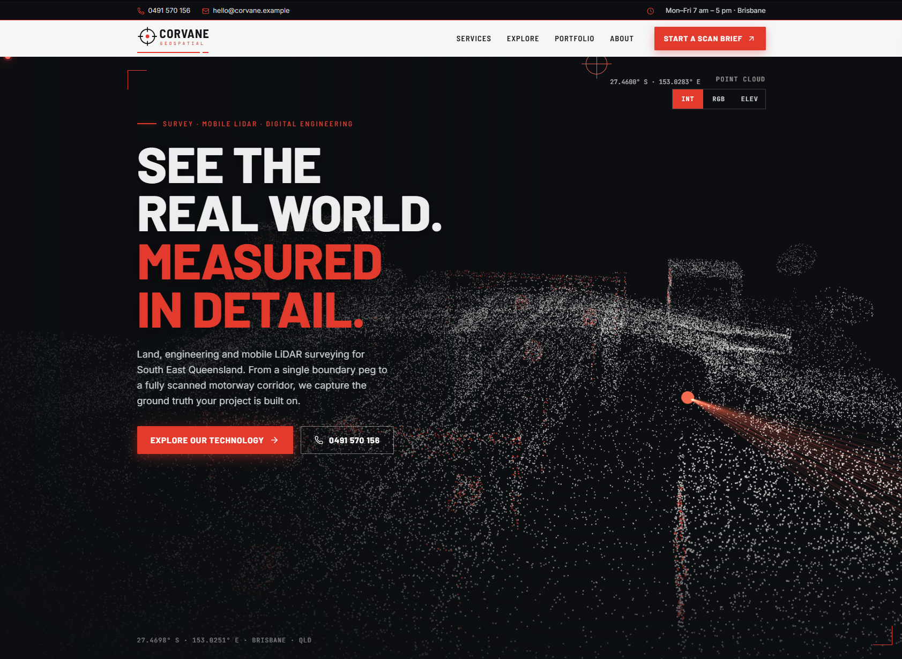
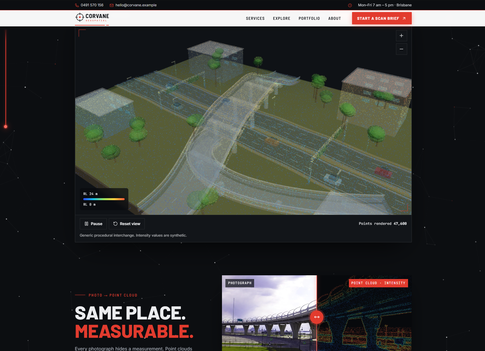

# Corvane Geospatial — surveying website concept

A portfolio website concept for **Corvane Geospatial**, a fictional surveying and mobile LiDAR firm in Brisbane. The company, people, projects and testimonials are invented. A banner above the site and the footer both say so.

Built with Next.js (App Router), React, TypeScript, Tailwind CSS, Three.js / React Three Fiber and Motion.

**Live demo (temporary):** https://corvane-geospatial-demo.vercel.app/





## What it shows

- A procedural interchange scene (terrain, carriageways, overpass, ramp, supports). It is generated in code and sampled into a point cloud with `THREE.Points`, with RGB, Elevation and synthetic Intensity colour modes, plus pause, reset and zoom.
- A hero point cloud with a scan animation, and a photo → point-cloud comparison slider re-sampled on a 2D canvas.
- A simulated single-scanner capture counter: deterministic, persisted in `sessionStorage`, Brisbane time.
- A responsive single page (360 px and up), keyboard and reduced-motion support, and a static fallback when WebGL is unavailable.
- A footer with office hours and an embedded Google Map.

## Run locally

```bash
npm ci
npm run dev        # http://127.0.0.1:3000
npm run lint && npm run typecheck && npm test && npm run build
```

Regenerate the scene stills: `npx tsx scripts/generate-fallback.ts` (viewer fallbacks) and `npx tsx scripts/generate-gallery.ts` (gallery).

## Content and media

- All copy lives in `src/content/company.ts`, and imagery and sample content in `src/content/showcase.ts`.
- The contact details are fictional on purpose. The phone number is in ACMA's range reserved for fictional use, and the email uses the reserved `.example` domain. The street is a real Brisbane street with no building number.
- The contact form only confirms on screen. Nothing is sent or stored.
- Media sources are listed in [`docs/assets.md`](docs/assets.md).

## Deployment

Deployed on Vercel. See `docs/assets.md` for media licences before reusing anything.
